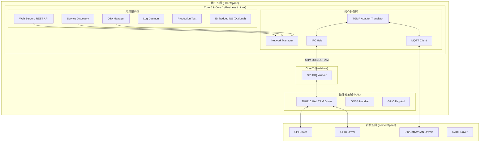
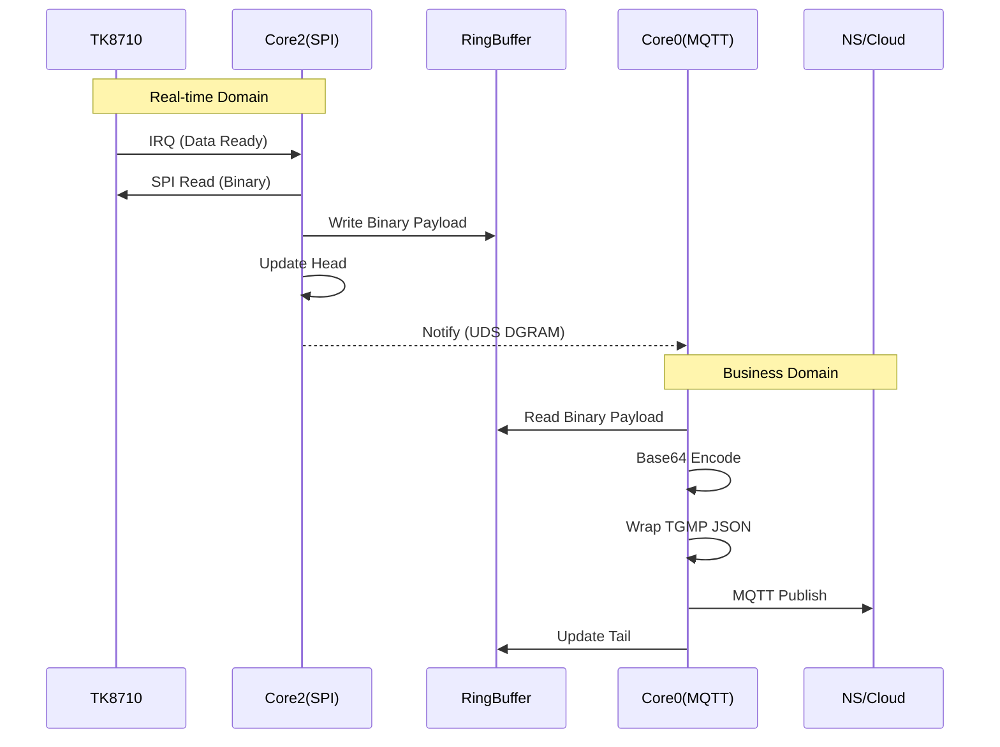
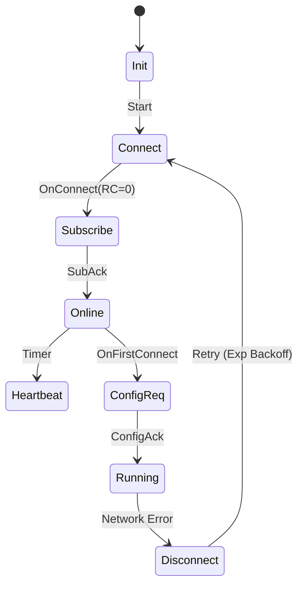
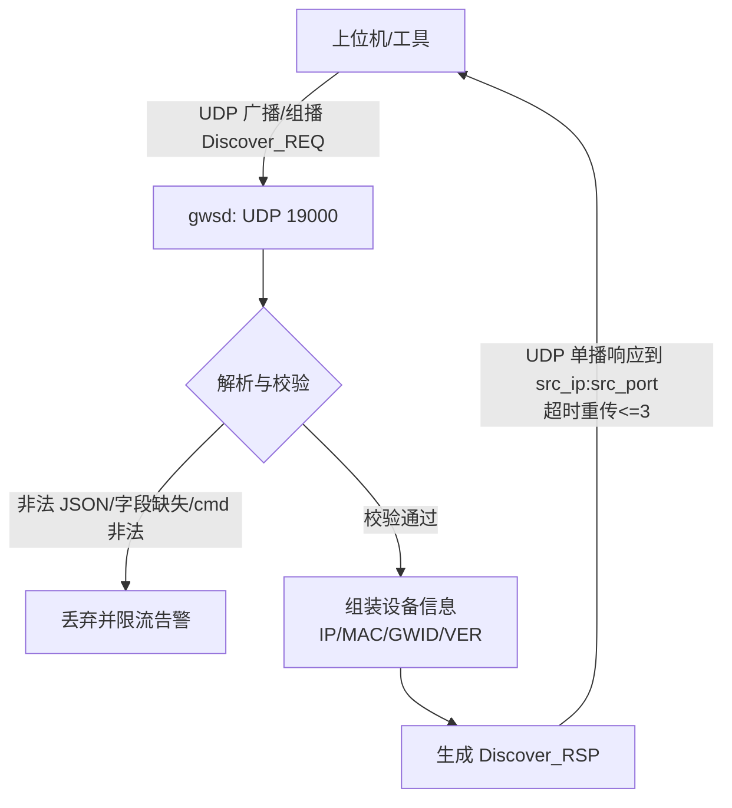
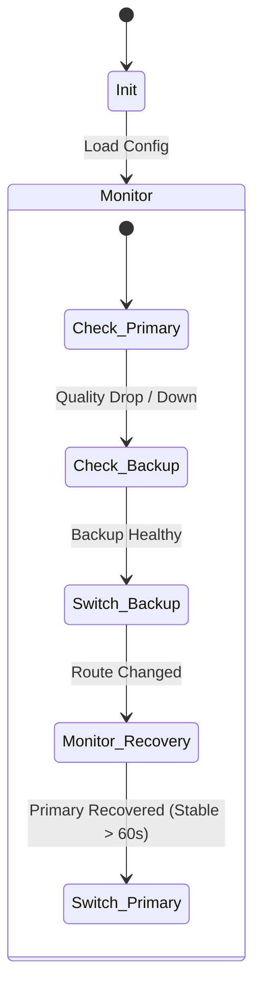
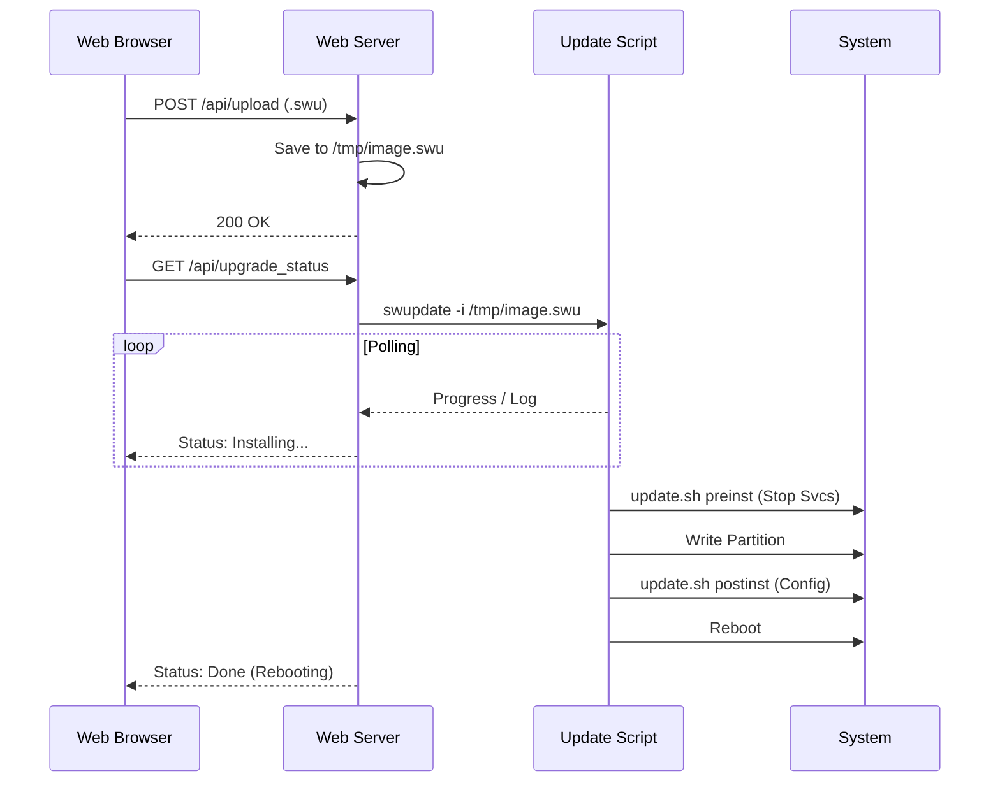

# TLG-880 网关软件详细设计

**版本：** V0.2.1
**日期：** 2026-03-09
**状态：** 详细设计 (Codebase Aligned & Enhanced)

---

## 文档修订记录

| 版本 | 日期 | 修改人 | 修改描述 | 审核人 |
| :--- | :--- | :--- | :--- | :--- |
| V0.1 | 2026-01-15 | 王西刚 | 初始版本创建 | |
| V0.2 | 2026-03-09 | 王西刚 | 1. 硬件平台变更为 RK3506B (512MB/8GB)<br>2. 架构升级为 SMP 多核亲和性 (Core0/1 业务, Core2 实时)<br>3. 新增 IPC 核间通信机制 (RingBuffer + UDS)<br>4. 更新南向 HAL/TRM/Driver 分层设计<br>5. 细化 TGMP 协议字段与配置流程<br>6. 更新分区表与内存预算 | |
| V0.2.1 | 2026-03-10 | 王西刚 | 1. 补充 IPC 协议设计理由与时序图 <br>2. 补充 MQTT 连接状态机与具体消息类型定义<br>3. 完善 Web 架构 (资源分离) 与 OTA 升级时序<br>4. 细化网络管理接口实现逻辑<br>5.变更web配置和日志相关的描述。 | |

---

## 1. 引言

### 1.1 编写目的
本文档在《TLG-880网关软件概要设计》《TurMass™ WAN 系统定义》《TurMass™ NS 规格书》《8710 driver 接口文档》《TurMass™ WAN终端规格书》的基础上，形成可实施的网关软件详细设计，明确模块职责、接口、数据结构、流程与运行约束。

### 1.2 适用范围
适用于 TLG-880 网关软件开发、集成测试、量产与运维阶段。

### 1.3 参考文档
- 《TLG-880 网关软件概要设计-V0.2.1》
- 《TurMass™ WAN 系统定义》
- 《TurMass™ NS 规格书 - v0.1》
- 《8710 driver 接口文档》
- 《TurMass™ WAN终端规格书 - v0.2》
- 《RK3506b_SMP_跨核通信机制设计.md》
- 《Mongoose Web 接口开发计划.md》

---

## 2. 系统定位与网关职责

### 2.1 硬件平台概述
- **主控芯片**: RK3506B (ARM Cortex-A7 SMP Dual-Core + MCU) - *注: 实际运行于 Linux SMP 模式*
- **基带芯片**: TK8710 (TurMass™ PHY)
- **存储资源**: 512MB DDR3 RAM / 8GB eMMC Flash
- **网络接口**: 
  - 1x Ethernet (10/100M RJ45)
  - 1x Cat.1 (USB模组)
  - 1x WLAN (SDIO 接口, 支持 AP/STA)

### 2.2 网关核心职责
- **无线接入汇聚**：承载终端空口接入，执行 TDD 时隙收发与多天线接收。
- **协议转换与转发**：将空口数据封装为 TGMP JSON，通过 MQTT 与 NS 交互。
- **网络管理与运维**：提供网络连接管理(Ethernet、Cat.1、WLAN)、Web 运维、日志、OTA 升级、量产产测。
- **可选本地组网**：内置轻量级 NS（ChirpStack 裁剪版），在无公网环境下提供本地服务。

---

## 3. 设计目标与约束

### 3.1 设计目标
- **实时性**：利用 SMP 架构隔离实时任务，确保 SPI 读写与中断响应 < 100µs。
- **稳定性**：支持断线重连、网络切换与关键任务隔离。
- **低开销**：在 512MB 内存限制下，优化内存池与零拷贝路径。

### 3.2 运行约束
- **操作系统**：Buildroot 构建的 Linux 6.1
- **网络**：优先使用 Ethernet，Cat.1/WLAN 作为备份。
- **时隙**：严格遵循 TurMass TDD 帧结构与 NS 下发配置。

---

## 4. 软件总体架构

### 4.1 分层结构与 CPU 亲和性
系统利用 RK3506B 的多核特性，采用 **SMP (Symmetric Multi-Processing)** 架构并进行 **CPU 亲和性绑定**。



### 4.2 任务分配 (CPU Affinity)
| 任务组 | 绑定核心 | 说明 |
| :--- | :--- | :--- |
| **Business** | Core 0, Core 1 | 运行 Linux 内核调度、MQTT 客户端、Web 服务器、日志服务、网络管理、TGMP 协议转换等非实时任务。 |
| **Real-time** | Core 2 | **独占运行** TK8710 驱动的数据收发线程、TDD 时隙调度、SPI 通信，确保微秒级的中断响应延迟。 |

### 4.3 核间通信机制 (IPC)

#### 4.3.1 设计原则 (Design Rationale)
- **零拷贝数据面**：SPI 采集的数据直接写入共享内存 RingBuffer，Core0/1 直接读取，避免内核态拷贝。
- **Core2 零处理**：**严禁**在 Core2 (SPI 核) 进行 Base64 编码或 JSON 序列化。这些操作耗时 (32KB 数据需 ~3ms) 会导致 SPI FIFO 溢出和中断抖动。所有协议转换工作由 Core0/1 承担。
- **无锁并发**：采用 SPSC (Single Producer Single Consumer) 模型，读写指针分离，无需互斥锁。

#### 4.3.2 通信时序图 (Sequence Diagram)



#### 4.3.3 核心数据结构 (ipc_smp.h)

**IPC 消息头 (`ipc_smp_msg_hdr_t`)**
| 名称 | 类型 | 描述 |
| :--- | :--- | :--- |
| version | uint16_t | 协议版本 (Current: 1) |
| type | uint16_t | 消息类型 (0x1001=MQTT->SPI, 0x2001=SPI->MQTT) |
| len | uint32_t | 负载长度 |
| seq | uint32_t | 序列号 |
| reserved | uint32_t | 保留 (对齐用) |
| ts_ns | uint64_t | 时间戳 (纳秒) |
| flags | uint32_t | 标志位 (e.g. HIGH_PRIO) |
| crc32 | uint32_t | 校验和 |

**IPC 配置结构 (`ipc_smp_cfg_t`)**
| 名称 | 类型 | 描述 |
| :--- | :--- | :--- |
| shm_name | const char* | 共享内存名称 (e.g. "/ipc_mqtt_to_spi") |
| ring_size | size_t | 环形缓冲区大小 (Default: 1MB) |
| max_msg_size | uint32_t | 最大单条消息大小 (Default: 2KB) |
| batch_count | uint32_t | 批量处理数量 (Default: 8) |
| flush_timeout_ms | uint32_t | 刷新超时时间 (Default: 20ms) |

#### 4.3.4 通知机制 (Notification)
- **机制**: **Unix Domain Socket (DGRAM)** 配合 **抽象命名空间 (Abstract Namespace)**。
- **优势**: 相比 `eventfd`，支持无亲缘关系的进程间通信；相比文件系统 Socket，无需清理文件残留。
- **流程**: Producer 发送 1 字节数据 -> Consumer `epoll` 唤醒。

#### 4.3.5 消息类型与负载布局 (Message Types & Payload)
- **类型枚举 (`hdr.type`)**
  - `0x1001`：业务域 -> 实时域（下行），载荷为待发二进制数据块
  - `0x2001`：实时域 -> 业务域（上行），载荷为采集到的二进制数据块
  - `0x3001`：控制/心跳
- **字节序与对齐**
  - 头部字段采用 **Little-Endian**，8 字节对齐；载荷按字节对齐
- **上行载荷（示例约定）**
  - `slot`(u8), `rssi`(i8), `snr`(i8), `flags`(u8)，后接变长 `payload`(u8[])
- **下行载荷（示例约定）**
  - `slot`(u8), `flags`(u8)，后接变长 `payload`(u8[])
- **大小约束与分片**
  - 单条消息最大 `max_msg_size`（默认 2KB），超过需在业务层分片并在应用层重组

#### 4.3.6 策略与观测性
- **背压策略**：写指针追尾超过水位线时丢弃低优先级消息（按 `hdr.flags`），并记录丢弃计数
- **指标采集**：ring 使用率、丢弃计数、平均批处理条数、通知延迟（UDS 收到到消费间隔）
- **错误处理**：CRC 校验失败/长度非法的消息直接丢弃并计数；连续 N 次异常触发告警

#### 4.3.7 返回码与确认机制
- **发送返回码**：
  - `0`：成功
  - `ERR_FULL`：队列已满（Producer 背压）
  - `ERR_CONGESTION`：拥塞丢弃（策略性丢弃低优先级）
- **接收返回码**：
  - `0`：成功取出一条消息
  - `ERR_EMPTY`：当前无可读消息
- **确认与维护**：
  - 消费完成需执行 `ack(seq)` 释放对应片段
  - 周期性维护：即使无事件唤醒，也需执行超时刷新（批处理批次超时、通知补发）

### 4.4 进程模型、启动顺序与亲和性

#### 4.4.1 应用进程清单
| 进程 | 主要职责 |
| :--- | :--- |
| `logd` | 统一日志采集、写文本，提供关键事件审计。 |
| `netguard` | 三网链路管理（探测、路由/DNS 切换、配置热重载）。 |
| `gwsd` | 网关服务发现（UDP 19000），发现请求校验与单播响应。 |
| `spi_rt` / `spi_app` | SPI 实时收发、GPIO IRQ 监听、与业务域 IPC。 |
| `mqttd` | MQTT 连接状态机、订阅/发布、TGMP 组包与编解码、与 SPI IPC。 |
| `webd` | Web 管理（REST API、配置下发、状态查询、固件上传）。 |
| `otad` | OTA 执行与进度管理，升级前停止业务进程，升级后恢复。 |

#### 4.4.2 启动顺序
启动顺序以“依赖满足、可观测性优先”为原则。

1. `logd`
2. `netguard`
3. `webd`
4. `gwsd`
5. `spi_rt` / `spi_app`
6. `mqttd`
7. `otad`


#### 4.4.3 CPU 亲和性与调度建议
| 进程 | CPU 亲和性 | 说明 |
| :--- | :--- | :--- |
| `spi_rt` / `spi_app` | **Core 2 独占** | 实时域，避免业务域抢占导致 SPI/IRQ 抖动；禁止在该域进行 JSON/Base64 等高耗时处理。 |
| `mqttd` | Core 1 固定 | 编解码与网络收发持续占用，固定到单核降低抖动并便于性能评估。 |
| `netguard` | Core 0 固定 | 探测/决策为主，放置在系统管理核，避免影响 mqttd 的持续负载。 |
| `webd` | Core 0 固定 | 交互型负载，默认与系统管理核放置；如页面压测后负载偏高，可改为 Core1。 |
| `gwsd` | Core 0 固定 | 轻量 UDP 监听与响应，放置在系统管理核。 |
| `logd` | Core 0 固定或 Core0/1 浮动 | I/O 为主；日志量大时固定到 Core0 并限流，避免与 mqttd 抢占。 |
| `otad` | Core 1 固定或 Core0/1 浮动 | 解包/校验/写盘可能阶段性消耗 CPU，避免与 webd/netguard 同核造成卡顿。 |

#### 4.4.4 退出与重启策略
**统一策略**
- 所有进程均由守护机制拉起，异常退出自动重启。
- 自动重启采用顺序和前置检查重启。
- 断网/断链优先内部状态机自愈（重连/恢复），不以“退出进程”作为常规恢复手段。

**按进程分级**

| 进程 | 退出条件 | 重启策略 |
| :--- | :--- | :--- |
| `spi_rt` / `spi_app` | 仅在不可恢复错误退出（设备节点长期不可用、IPC 初始化失败等）。 | 立即重启；若短时间内连续失败（如 5 次/5 分钟），升级为系统级故障处理（触发系统重启或进入降级告警模式）。 |
| `netguard` | 不退出； | 上电重启或是手动重启 |
| `mqttd` | 初始化失败、配置不可解析等启动期致命错误可退出；运行期断链不退出。 | 异常退出重启；重启后重新订阅 Topic 并恢复配置请求流程。 |
| `webd` | 端口绑定失败、资源初始化失败等启动期致命错误可退出。 | 异常退出重启；重启后恢复 API 服务与配置读入。 |
| `gwsd` | 启动期端口绑定失败可退出；运行期异常尽量自恢复。 | 异常退出重启；确保在 `mqttd` 之前启动。 |
| `logd` | 尽量不退出；磁盘满等情况降级（限流/丢弃低优先级日志）。 | 异常退出立即重启；保证系统可观测性。 |
| `otad` | 任务型进程可在任务结束后退出；升级阶段不应被外部随意终止。 | 升级中断需记录状态并可恢复/回滚；升级前停止 业务进程，升级后按本节启动顺序恢复。 |

---

## 5. 南向接入层 (Southbound Access)

### 5.1 TK8710 适配模块
#### 5.1.1 模块职责
- 完成 TK8710 初始化、射频配置、时隙配置与收发控制。
- 采用 **HAL(API) / TRM(收发管理) / Driver(硬件驱动)** 三层架构。

#### 5.1.2 核心 API
- `HAL_init(config)`: 初始化驱动与回调。
- `HAL_config(rate_table, slot_cfg)`: 配置速率与时隙参数。
- `HAL_start(mode)`: 启动 TDD 工作模式。
- `HAL_sendData(slot, data, len)`: 写入下行数据。
- `HAL_getStatus()`: 获取当前 RSSI/SNR/Sync 状态。

### 5.2 SPI Driver 模块 (spi_app)
#### 5.2.1 配置与参数 (spi_app.h)
- **设备路径**: `/dev/spidev0.0`
- **IPC 通道**:
  - MQTT -> SPI: `/ipc_mqtt_to_spi` (Type: `0x1001`)
  - SPI -> MQTT: `/ipc_spi_to_mqtt` (Type: `0x2001`)
- **缓冲区参数**: Ring Size 1MB, Max Msg 2KB, Batch 8。

#### 5.2.2 主循环逻辑
```c
void spi_app_run(void) {
    while (running) {
        // 1. 处理 IPC 下行消息 (MQTT -> SPI)
        ipc_smp_recv(ch_mqtt_to_spi, &msg, 0);
        if (msg) HAL_sendData(msg.slot, msg.payload, msg.len);
        
        // 2. 处理 SPI 上行数据 (SPI -> MQTT)
        // (由 HAL 回调触发 ipc_smp_send)
        
        // 3. 周期性维护 (Watchdog/Stats)
    }
}
```

## 6. GPIO 设计
基于 `libgpiod` 实现用户态 GPIO 控制，避免内核态上下文切换开销。

### 6.1 IO简例
- **IRQ**: 监听 `/dev/gpiochip0` **Line 18**，配置为 **Rising Edge** 触发。
- **亲和性**: 线程强制绑定至 **CPU 2** (`sched_setaffinity`)。
- **LED 定义**:
  - `Run`: 系统心跳 (每秒翻转)。
  - `Net`: 网络状态 (常亮=Online, 闪烁=Connecting/Offline)。
  - `Power`: 电源指示 (上电常亮)。
- **KEY**: 复位按键 (按下 > 5s 触发 Factory Reset)。

### 6.2 操作接口

<table>
  <thead>
    <tr>
      <th>操作</th>
      <th>C操作示例</th>
      <th>返回值(C操作)</th>
      <th>Shell操作示例</th>
    </tr>
  </thead>
  <tbody>
    <tr>
      <td>打开</td>
      <td><code>gpiod_chip_open_by_name("gpiochip0")</code><br/><code>gpiod_chip_get_line(chip, 18)</code></td>
      <td>失败返回 NULL，并设置 errno</td>
      <td><pre><code>gpiodetect
gpioinfo gpiochip0</code></pre></td>
    </tr>
    <tr>
      <td>设置(输出方向)</td>
      <td><code>gpiod_line_request_output(line, "app", 1)</code></td>
      <td>返回 0 成功；返回 -1 失败，并设置 errno</td>
      <td><pre><code>gpioset gpiochip0 18=1</code></pre></td>
    </tr>
    <tr>
      <td>读取(输入电平)</td>
      <td><code>gpiod_line_request_input(line, "app")</code><br/><code>gpiod_line_get_value(line)</code></td>
      <td>request: 0 成功 / -1 失败(errno)<br/>get: 0/1 电平 / -1 失败(errno)</td>
      <td><pre><code>gpioget gpiochip0 18</code></pre></td>
    </tr>
    <tr>
      <td>输出(写电平)</td>
      <td><code>gpiod_line_set_value(line, 1)</code></td>
      <td>返回 0 成功；返回 -1 失败，并设置 errno</td>
      <td><pre><code>gpioset gpiochip0 18=0</code></pre></td>
    </tr>
  </tbody>
</table>


## 7. 北向接入层 (Northbound Access)

### 7.1 MQTT 客户端模块
#### 7.1.1 模块职责
- **协议**: MQTT 5.0 (基于 `libmosquitto`)。
- **机制**: 异步事件循环，集成 IPC 轮询。

#### 7.1.2 连接状态机 (Connection FSM)


1. **Connect**: 连接 Broker。
2. **Subscribe**: 订阅 `sub_topic`。
3. **ConfigReq**: 发送 `{ "get_config": true }`。
4. **Running**: 进入主循环，处理 IPC 消息与 MQTT 消息。

#### 7.1.3 配置参数 (config.json)
| 参数名 | 类型 | 默认值 | 说明 |
| :--- | :--- | :--- | :--- |
| mqtt_host | string | "192.168.1.100" | Broker IP |
| mqtt_port | int | 1883 | 端口 |
| client_id | string | "123456" | 网关 ID |
| pub_topic | string | "tkg123456/msg/up" | 上行 Topic |
| sub_topic | string | "tkg123456/msg/downlink" | 下行 Topic |
| heartbeat_interval | int | 60 | 保活间隔 (s) |

#### 7.1.4 安全与 TLS
- **TLS**：支持 CA 校验与双向证书（可配置 `cafile`、`certfile`、`keyfile`）
- **主机名校验**：默认启用，`tls_insecure` 默认为 `false`
- **证书路径**：建议放置 `/etc/ssl/tlg880/`（权限 600），配置平台商提供并在出厂写入(或超级权限变更)。

### 7.2 协议转换核心 (Protocol Translator)

#### 7.2.1 上行转换 (Uplink)
- **输入**: IPC Binary Message (Type `0x2001`)
- **处理**:
  1. 解析 IPC Header 获取 `ts_ns`。
  2. 提取 Binary Payload。
  3. 执行 Base64 编码。
  4. 组装 JSON: `{ "slot": 2, "msg": "Base64...", "rssi": -70 ... }`。
- **输出**: MQTT Publish。


#### 7.2.2 下行转换 (Downlink)
- **输入**: MQTT JSON Message (Topic `.../downlink`)
- **处理**:
  1. 解析 JSON 获取 `slot` 和 `msg` (Base64)。
  2. 执行 Base64 解码 -> Binary。
  3. 封装 IPC Header (Type `0x1001`)。
- **输出**: IPC Send to Core2。


## 8. 网关 SD（服务发现）

- **监听端口**: UDP 19000
- **响应**: JSON 格式的设备信息 (IP, MAC, GWID, Ver)。



### 8.1 监听机制
- 进程名称: gwsd (Gateway Service Discovery)，以守护进程方式运行。
- 启动时机: 早于 Web 管理与 MQTT 客户端。
- 广播协议: 支持 UDP 广播与组播两种：
  - 广播: 255.255.255.255:19000
- 报文格式: JSON，最大长度 512B，校验字段 。
- 调度与自恢复:
  - 监听周期: epoll 非阻塞，select 超时 200ms 轮询。
  - 异常退出: 由守护进程自动拉起。

### 8.2 接收与解析
- 有效查询广播判定:
  - `magic`: "TGSD" (TurMass Gateway Service Discovery)
  - `ver`: 1 (向后兼容预留)
  - `vendor`: "TurMass"
  - `cmd`: 0x01 (DISCOVER_REQ)
- 其他规则: 非法 JSON、字段缺失、`cmd` 非法。

#### 8.2.1 JSON 规范化
- **编码**：UTF-8；布尔与数字使用标准 JSON 表示，不允许前导零
- **键顺序**：请求/响应采用固定键顺序序列化（例如：`magic,ver,vendor,cmd,ts,data`）。
- **序列化规则**：无多余空白；对象键按上述顺序；数组按自然顺序
- **一致性**：各端必须使用相同的规范化流程；校验失败直接丢弃并记录

### 8.3 信息组装
- 上报四元组字段与获取策略:
  - IP 地址: 优先顺序 `eth1(静态) > eth1(DHCP) > lo`，支持 IPv4/IPv6；若双栈同时存在，按数组返回，v4 在前。
  - MAC 地址: 取首个可用物理网卡 (非 lo/非虚拟)，格式为 `xx:xx:xx:xx:xx:xx` 小写十六进制。
  - GWID: 32 字节字符串，文件存在直接读取，没有为空。
  - VER: 同心跳上报的版本一致。
- JSON 响应字段与顺序 (示例)：
```json
{
  "magic": "TGSD",
  "cmd": 129,
  "data": {
    "ip": ["192.168.1.10", "fe80::1234"],
    "mac": "00:11:22:33:44:55",
    "gwid": "123456789",
    "ver": "1.2.3+20260309"
  }
}
```
说明：`cmd=0x81(DISCOVER_RSP)`；

### 8.4 上报机制
- 传输协议: UDP 单播响应，目标 `src_ip:src_port`；应答超时 300ms，失败重传最多 3 次。
- 安全要求: 明文上报仅包含非敏感标识。

---

## 9. 网络管理层 (Network Management)

### 9.1 架构升级：基于守护进程的三网切换 (NetGuard Daemon)
系统摒弃简单的轮询脚本，引入独立的 **NetGuard Daemon** 守护进程，负责全生命周期的链路管理。

- **进程名称**: `netguard`
- **核心职责**:
  - **链路监控**: 实时监测 Ethernet (eth1), Cat.1 (ppp0), Wi-Fi (wlan0) 的物理状态与逻辑连通性。
  - **决策执行**: 基于优先级算法与实时探测数据，自动切换默认路由与 DNS。
- **运行机制**: 
  - 检测机制：按照web的设定进行检测。
  - 故障转移目标：**< 3分钟** 完成从故障检测到新链路生效。

### 9.2 网络接口实现 (network_manager.c)
- **解析对象**: `/etc/network/interfaces`。
- **模式支持**:
  - `static`: 解析 `address`, `netmask`, `gateway`。
  - `dhcp`: 识别 `iface eth1 inet dhcp`。
- **运行时获取**: 使用 `ioctl(SIOCGIFADDR)` 获取当前生效 IP。
- **Ping 工具**: 使用 `popen("ping -c 4 <target>", "r")` 执行并捕获输出。

### 9.3 RK3506B 开发板 Wi-Fi 配置接口

#### 9.3.1 AP 模式配置 (Hostapd)
- **配置文件**: `/etc/hostapd.conf`
- **源文件引用**: 需新增至 `rootfs_overlay/etc/hostapd.conf` (参考 `web/src/network_manager.c` 实现配置覆写)

```ini
interface=wlan0
driver=nl80211
ssid=TurMass_Gateway_XXXX
hw_mode=g
channel=6
auth_algs=1
wpa=2
wpa_key_mgmt=WPA-PSK
wpa_pairwise=TKIP CCMP
rsn_pairwise=CCMP
wpa_passphrase=DEPLOYMENT_REQUIRED
```

#### 9.3.2 Client (STA) 模式配置 (WPA Supplicant)
- **配置文件**: `/etc/wpa_supplicant.conf`
- **源文件引用**: 需新增至 `rootfs_overlay/etc/wpa_supplicant.conf`

```ini
ctrl_interface=/var/run/wpa_supplicant
update_config=1

network={
    ssid="Target_SSID"
    psk="Target_Password"
    priority=1
}
```

#### 9.3.3 Wi-Fi 控制接口定义 (伪代码)
基于 `system()` 调用 `hostapd` / `wpa_supplicant` 或修改配置文件。建议扩展 `web/src/network_manager.c`。

**Shell 命令接口**

```bash
# AP 开启
hostapd -B /etc/hostapd.conf

# STA 连接
wpa_supplicant -B -i wlan0 -c /etc/wpa_supplicant.conf
udhcpc -i wlan0

# Reload (不重启服务仅重读配置)
killall -HUP hostapd
wpa_cli reconfigure
```


**切换与重启策略**
1.  **模式切换 (AP <-> STA)**: 必须先 `killall` 当前服务，`ifdown wlan0`，再启动新服务。
2.  **配置修改**:
    -   **AP**: 修改配置后需 `killall hostapd && hostapd ...` (重启服务)。
    -   **STA**: 支持运行时重连 `wpa_cli select_network <id>`，若修改 SSID 则需重启 `wpa_supplicant`。

### 9.4 Cat.1 模组虚拟网卡接口

#### 9.4.1 驱动与系统配置
- **内核配置**: `CONFIG_USB_SERIAL_OPTION`, `CONFIG_PPP`, `CONFIG_PPP_ASYNC`。
- **Udev 规则**: `/etc/udev/rules.d/99-cat1.rules`
    ```bash
    # 绑定 USB 串口到固定名称 (假设模组 VID/PID 为 1C9E:9B05)
    SUBSYSTEM=="tty", ATTRS{idVendor}=="1c9e", ATTRS{idProduct}=="9b05", SYMLINK+="ttyCAT1"
    ```
- **拨号脚本**: `/etc/ppp/peers/cat1` (引用自标准 Linux PPP 实现)
    ```bash
    /dev/ttyCAT1
    115200
    connect 'chat -v -f /etc/ppp/chat-cat1'
    noauth
    defaultroute
    usepeerdns
    ```

**状态监控集成**
- 监听 Netlink Socket (`RTM_NEWLINK` / `RTM_DELLINK`) 检测 `ppp0` 接口生成与消失。
- 拨号成功后，解析 `/var/run/ppp/resolv.conf` 获取 DNS。

### 9.5 三网切换逻辑实现 

#### 9.5.1 智能优先级算法
守护进程依据配置文件中的 `priority` 字段动态调整策略。默认策略如下：

| 优先级 | 链路类型 | 判定条件 (Score) | 备注 |
| :--- | :--- | :--- | :--- |
| **Tier 1** | Ethernet | L3级链路通信正常 | 首选高带宽低延时 |
| **Tier 3** | Wi-Fi STA | L3级链路通信正常 | 视信号质量降级(按配置) |
| **Tier 2** | Cat.1 4G | L3级链路通信正常 | 次选链路，按流量计费 |

#### 9.5.2 实时链路探测脚本逻辑
`netguard` 内部集成探测逻辑。

- **探测指标**:
  - **Latency**: `ping -c 5 -W 1 DNS` 计算平均 RTT。
  - **Packet Loss**: 统计丢包率，若丢包率 > 10% 则判定链路不可用。

**状态机流转 (FSM)**



#### 9.5.3 故障转移机制
1.  **判定阶段**: 连续 3 个探测周期 (Default: 10s * 3) 指标不达标。
2.  **执行阶段**:
    -   修改路由表: `ip route replace default via <GW> dev <IFACE> metric <PRIO>`
    -   更新 DNS: 重写 `/etc/resolv.conf`。
    -   清理旧连接: 杀死网路进程。
3.  **恢复阶段**: 
    -   主链路恢复探测开启 (Interval: 30s)。
    -   **防抖动 (Hysteresis)**: 主链路需连续稳定 60s 方可回切。

### 9.6 Web 配置管理系统

#### 9.6.1 前端交互设计
- **配置界面**:
  - **模式选择**: 表单 [ 自动切换 (Auto) | 强制以太网 | 强制 4G | 强制 Wi-Fi ]。
  - **状态看板**: 实时高亮当前活跃链路 (Active)。
  - **验证机制**: 
    - IP/Mask 正则校验。
    - 网关可达性预检 (点击 "ping" 按钮触发后端 Ping)。

#### 9.6.2 后端实现架构
- **配置文件**: `/etc/netguard/config.json`
- **权限控制**: `chmod 600` (仅 root 读写)。
- **版本控制**: 保留最近 5 个版本 (`config.json.v1` ~ `v5`)，支持一键回滚。

**配置示例 (JSON)**
```json
{
  "version": "1.0",
  "mode": "auto",
  "check_interval": 10,
  "switch_threshold": 3,
  "interfaces": [
    {
      "name": "eth1",
      "priority": 100,
      "target": "8.8.8.8"
    },
    {
      "name": "ppp0",
      "priority": 50,
      "target": "114.114.114.114"
    }
  ]
}
```
说明：`mode` 支持取值 `auto`、`manual_eth`、`manual_4g`、`manual_wifi`。

#### 9.6.3 变更监听与重载
1.  **用户保存**: Web Server 写入 `config.json.tmp` -> 校验 JSON -> 备份旧版 -> 覆盖 `config.json`。
2.  **信号触发**: Web Server 执行 `killall -HUP netguard` 。
3.  **Daemon 行为**: 收到信号/事件 -> 读取新配置 -> 调整探测策略 (无需重启网关)。

### 9.7 服务管理与回滚
- **依赖声明**: `netguard` 依赖网络驱动就绪；`webd` 依赖存储与端口可用；`mqttd` 依赖网络连通。
- **热重载**: 对 `config.json` 的变更通过`netguard` 实现无损重载；

---

## 10. Web服务层 (System Services)

### 10.1 Web 管理架构
基于 **Mongoose** 框架，采用模块化设计。

#### 10.1.1 资源分离架构
为了提高嵌入式 Web 的加载速度与开发效率：
- **HTML/CSS**: 存放在 `web_resources/` 目录。
- **构建工具**: `gen_resources.py` 在编译时将文件转换为 C 字符串头文件 (`web_resources.h`)。
- **优势**: 单一可执行文件，无文件系统依赖。

#### 10.1.2 核心 API 定义
| 方法 | 路径 | 功能 | 参数示例 |
| :--- | :--- | :--- | :--- |
| GET | `/api/status` | 获取系统状态 | - |
| POST | `/api/config` | 修改 MQTT 配置和RF配置 | `{ "mqtt_host": "..." }` |
| POST | `/api/network` | 修改网络配置 | `{ "type": "static", "ip": "..." }` |
| POST | `/api/upload` | 上传固件 | Multipart Form Data |
| GET | `/api/upgrade_status` | 获取升级进度 | - |

#### 10.1.3 OTA 升级时序图


#### 10.1.4 回滚与断电保护
- **镜像处理**：升级镜像先加载至内存（或 `/tmp` tmpfs），老的固件迁移至 oem 备份区，校验通过后再写入目标分区，备份区保留上一个可运行版本。
- **回滚机制**：启动失败计数触发回滚到上一可用版本；保留 1 个版本记录
- **配置迁移**：升级后执行 `postinst` 比对与迁移配置，失败则回滚迁移并保留备份

## 11. 运维与产测 (Operations & Production)


### 11.1 分区规划
存储介质：**eMMC 8GB**。

| 分区名 | 大小 (MB) | 文件系统 | 描述 |
| :--- | :--- | :--- | :--- |
| uboot | 4 | Raw | U-Boot Bootloader |
| misc | 4 | Raw | Boot Control / Misc |
| boot | 64 | Ext4 | Kernel Image + DTB |
| recovery | 128 | Ext4 | Recovery System Image |
| rootfs | 6144 | SquashFS | Read-only Root Filesystem |
| oem | 128(出厂文件，测试程序) | Ext4 | Factory Data (SN/MAC/Cert) |
| userdata | 剩余 (~1.5GB) | Ext4 | User Data / Logs / Overlay |

### 11.2 OTA 脚本流程 (update.sh)
- **preinst**: 停止业务进程 (`killall mypackage`)，释放文件句柄。
- **postinst**: 
  - 移动/重命名临时文件。
  - 修正权限 (`chmod 755`)。
  - 恢复配置或重启服务。

### 11.3 产测项(根据产测治具开发)

**产测模式进入方式**:
通过命令行执行 `factory_test_mode` 进入产测专用模式。该模式下将停止部分业务进程，释放 SPI/串口资源供测试程序独占。

1.  **SPI Loopback**  
    - 步骤：连接治具 -> 启动 loopback 程序 -> 发送固定序列 -> 校验回环数据一致性  
    - 指标：误码率 0；重复 20 轮无异常；SPI 时钟稳定在目标频率  
2.  **RF Calibration**  
    - 步骤：连接频谱/综测仪 -> 执行校准脚本 -> 记录频偏与功率  
    - 指标：待定
3.  **GPIO/LED/KEY**  
    - 步骤：按键按压/释放 -> 读取电平 -> LED 按预置节奏闪烁  
    - 指标：LED 符合设定  
4.  **Connectivity（以太网/Wi‑Fi/Cat.1）**  
    - 步骤：对每种链路分别执行以下连通性测试（各 20 包或 60 秒窗口）：  
      - `ping -c 20 223.5.5.5`（阿里 DNS）  
      - `ping -c 20 119.29.29.29`（腾讯 DNS）  
      - `ping -c 20 180.76.76.76`（百度 DNS）  
    - 指标：任一目标可达即判定链路连通；建议丢包率 ≤ 1%，记录 RTT Avg  

5.  **MQTT 连通性**  
    - 步骤：断开/恢复网络 -> 观察重连与订阅恢复  
    - 指标：断链后重连 ≤ 10s；消息往返成功率 100%（10 次）
6.  **SD 服务发现**  
    - 步骤：工具发起 Discover_REQ 
    - 指标：合法请求响应 ≤ 500ms；非法请求丢弃并计数  
7.  **OTA 升级回滚**  
    - 步骤：上传合法/非法镜像、模拟断电  
    - 指标：合法镜像升级成功并重启；非法镜像拒绝；断电后可回滚到上一版本  
8.  **记录模板**  
    - 基本信息：设备 MAC、时间(NTP)  
    - 指标字段：按以上项目分列；结果枚举 PASS/FAIL;
### 11.4 日志与指标规范
- **日志级别**: DEBUG/INFO/WARN/ERROR；默认 INFO；关键路径降级打印启用限流
- **格式**: `ts,level,msg`；统一保存到emmc，进行掉电不丢失保存`
- **轮转与留存**: 按大小 10MB*5 轮转，留存 X个文件(启动参数)，超限删除最旧文件
- **敏感信息**: 禁止输出密钥/口令/证书内容；必要时脱敏
- **采集与暴露**: 周期刷新到文本进行保存和新旧反转。
### 11.5 资源与性能预算
#### 11.5.1 常驻内存 PSS 预算（512MB）
| 模块/进程 | 预算占用 (PSS) | 状态 | 说明 |
| :--- | :--- | :--- | :--- |
| Kernel (内核) | 50 MB | 常驻 | 内核、网络栈、驱动 |
| System Base | 10 MB | 常驻 | init/udev/shell 等 |
| Network | 20 MB | 常驻 | 以太网/Wi‑Fi（hostapd/wpa_supplicant）、Cat.1（pppd）与 gwsd |
| Web (webd) | 5 MB | 常驻 | Mongoose/REST |
| MQTT (mqttd) | 5 MB | 常驻 | libmosquitto |
| Gateway Core | 15 MB | 常驻 | 协议转换、业务逻辑 |
| Log (logd) | 5 MB | 常驻 | 收集与轮转 |
| Embedded NS | 100 MB | 可选 | ChirpStack 全栈 |
| 其它 | 剩余 | 动态 | 缓冲/页缓存/临时对象 |

#### 11.5.2 峰值附加项（关键场景）
- OTA 临时文件：优先落盘 `userdata`；如走 tmpfs，需限定镜像 ≤ 可用 RAM 的 20% 且设置上限
- IPC RingBuffer：2 路 × 1MB（可调）
- TLS 握手峰值：1–2MB（视证书链与算法而定）
- 日志瞬时缓存：≤ 5MB（超限丢弃低优先级）

#### 11.5.3 性能目标
- SPI 中断至 IPC 通知 < 100µs（p95）
- 上行编码与发布延迟 < 150ms（局域网，p95）
- 三网切换故障转移 < 3 分钟；回切防抖 ≥ 60s
- MQTT 断链后重连 < 10s（指数退避受网络影响）

### 11.6 测试与验收矩阵（量化阈值）
- **IPC 实时域**：中断至通知 p95 < 100µs；异常丢弃计数=0（30min 运行）
- **网络管理**：故障转移 ≤ 180s；回切稳定时间 ≥ 60s；DNS/路由生效立即可验证
- **MQTT**：断链重连 ≤ 10s；QoS1 端到端成功率 100%（10 次）；编码/解码一致性 100%
- **SD**：合法请求响应 ≤ 500ms；非法请求丢弃率 100%；限流统计准确
- **OTA**：合法镜像升级成功；非法镜像拒绝；断电回滚到上一版本成功率 100%（3 次）
- **网络连通性**：以太网吞吐 、Wi‑Fi 、Cat.1 、对指定IP的连通性完好
---

## 12. 内置 NS（可选）
- **组件**: 集成 ChirpStack Gateway Bridge, Network Server, Application Server。
- **适配**: TurMass Adaptor 负责将 ChirpStack 调度映射到 TDD 时隙。
- **资源**: 启用后内存占用增加约 100MB，需通过配置显式开启。
