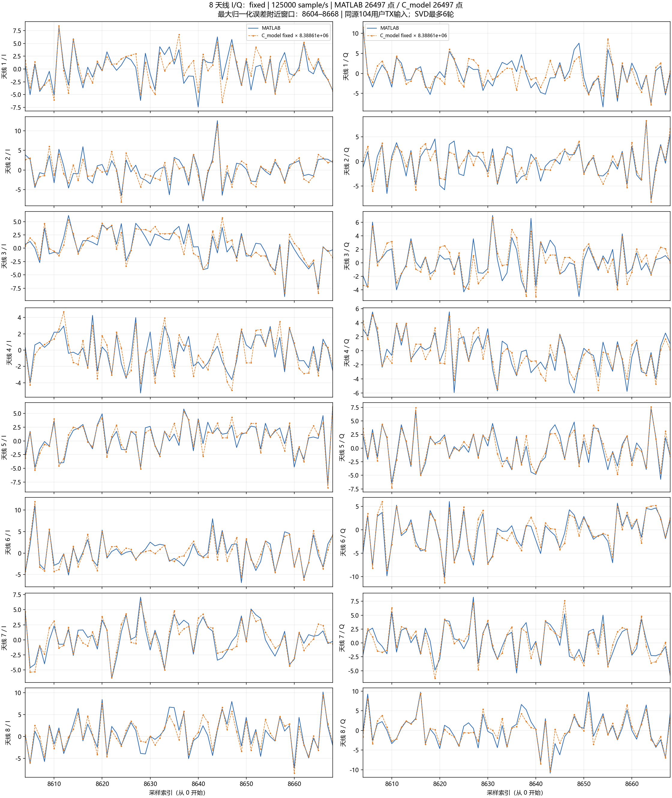

# MATLAB / C_model 8 天线 I/Q 对比图

模式：**fixed**；同源104用户TX输入；SVD最多6轮。采样率：125000 sample/s。

蓝色实线：MATLAB；橙色虚线：C_model，已乘固定缩放系数 8388608。

[8天线完整波形总图](all_antennas_full.png)

## 各天线 I/Q 完整波形、局部放大与误差

- [天线 1](antenna_01.png)
- [天线 2](antenna_02.png)
- [天线 3](antenna_03.png)
- [天线 4](antenna_04.png)
- [天线 5](antenna_05.png)
- [天线 6](antenna_06.png)
- [天线 7](antenna_07.png)
- [天线 8](antenna_08.png)

MATLAB 长度 26497，C_model 长度 26497；长度一致：True。
局部窗口 8604～8668，位于各天线按参考 RMS 归一后的最大误差附近。未进行波形对齐、重采样或增益/相位拟合。
局部窗口用于检查最明显差异，不代表整段波形。下表按共同长度计算；若长度不同，不能据共同部分指标判为一致。

| 天线 | 相对 L2 | 复数 RMSE | 最大绝对误差 |
|---|---:|---:|---:|
| 1 | 43.6502% | 1.94655 | 5.48727 |
| 2 | 36.3162% | 1.63856 | 4.02198 |
| 3 | 37.6847% | 1.58266 | 4.1098 |
| 4 | 38.5106% | 1.34254 | 3.60071 |
| 5 | 27.3839% | 1.14035 | 3.01955 |
| 6 | 30.2006% | 1.47638 | 3.84219 |
| 7 | 36.3114% | 1.51279 | 3.58726 |
| 8 | 39.4288% | 1.86458 | 4.78706 |

误差按整段复数能量归一化，不除以瞬时 I/Q，避免过零点夸大百分比。图像不替代接收解调、RTL或硬件验收。

[数据路径、哈希与绘图参数](plots.json)
