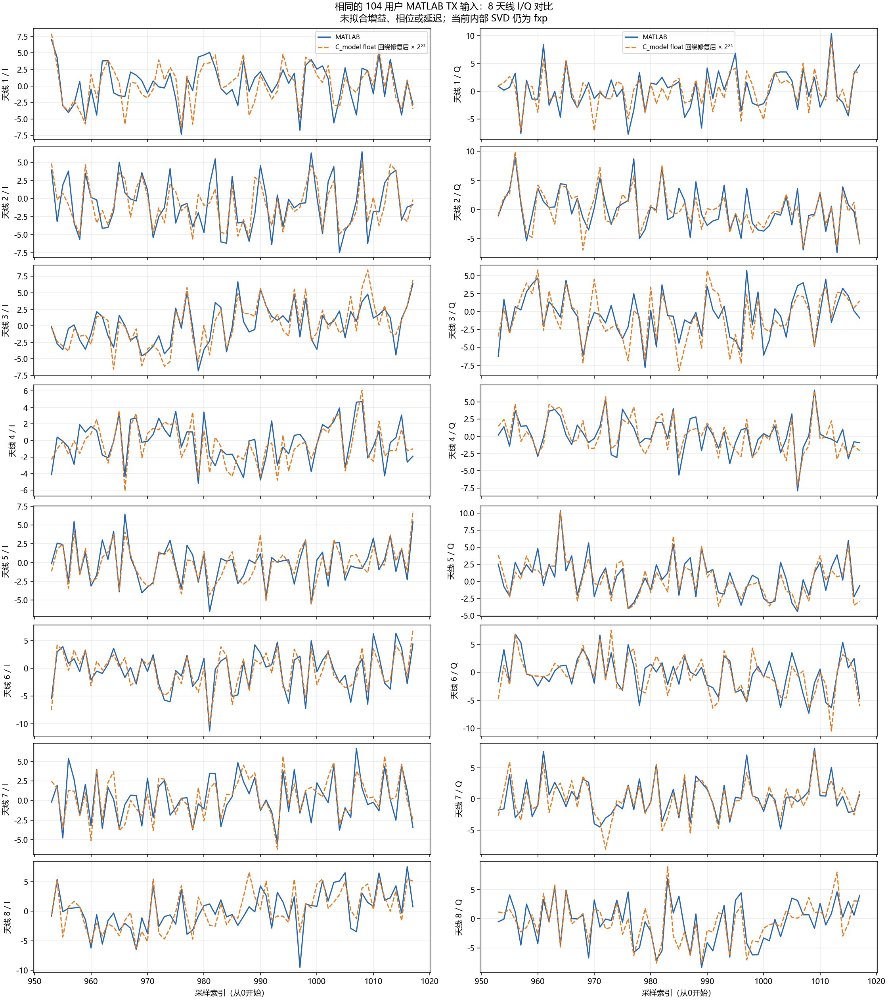

# 相同 MATLAB TX 输入与 float 相位回绕修复后对比

日期：2026-09-24。本轮按用户要求，直接导入 MATLAB 全部 TX 输入，正式修复 float 相位回绕，并重新比较 8 天线 TX。

输入来自此前 128 终端单帧中的 MATLAB 实际 TX 用户，共 **104 个**。C++ RX 仍可以解出 105 用户，但 TX 明确改用 MATLAB 的 104 用户、顺序和信道信息，不从 C++ RX 结果取 TX 参数。

**结果：输入已逐值核对一致、相位回绕回归通过，但总 TX 波形仍不一致；剩余主要差异已出现在波束权重。**

## 输入一致性

- MATLAB 从保存的 `matlab_one_frame.mat` 导出实际 `users`、`noise`、`calibration`、TX bit bank 和 91 项配置。
- 导入用户 ID/顺序、TX mode、频率、导频功率、每用户 TX 功率、8 天线 AH、8 天线噪声功率、8 路复数校准系数。
- 发射配置：mode14、1 block、48 PHY 字节、46 载荷字节、CRC 开、S/F=0、DSSS=1、TransRatio=0.25、前缀48点、125 ksample/s、全部8天线、总功率150、均分功率、MMSE=0、互易校准关闭。配置仍由 MATLAB 保存的参数文件传入。
- MATLAB 逐字节检验 bit bank 与实际传给 PHYGWTx 的载荷一致；C++ 在用户 ID 映射后回写实际使用的 bit 序列，脚本与 MATLAB 导出文件完整核对。
- C++ 回写实际使用的 AH/噪声/频率/功率/校准数值，脚本用双精度逐值相等检查，通过。
- 两边 TX 均为104用户、8天线、每路26497个复数采样；不再包含用户集合或载荷错配因素。

## 正式修复与回归

`Cls_tx_us_2_1.h` 的 float 输入显式执行 `p -= 2*floor((p+1)/2)`，逐级插值中点按 MATLAB 规则回绕。仅 `std::is_floating_point<T>` 分支启用；fixed 的量化/回绕规则保持原样。
4组真实8倍插值回归：修复前首个样例 sample1 的复数误差为0.765367，返回1；修复后全部通过。测试包含已知 -1.375π/2.86741748π 样例、正反跨周期及边界输入。
旧 fixed 单用户回归的 TX 哈希仍为 `3ddc3964e913ba7427d1368ba279e2c7d81a1684957009959af56014266c586f`。有效文件以及缺字段、多余字段、非有限噪声、负噪声、错误mode、重复ID共7项导入检查通过。

## 同一输入的前后对照

控制组复制当前入口及头文件，仅将上采样头文件替换为修复前备份；正式组使用修复后的当前源码。两组导入完全相同的 MATLAB TX 数据，且两组权重文件哈希相同，因此下面的变化只来自相位回绕修复。

| 天线 | 同输入、回绕修复前 L2 | 同输入、回绕修复后 L2 |
|---|---:|---:|
| 1 | 61.9890% | 60.3971% |
| 2 | 58.5573% | 56.8895% |
| 3 | 55.1497% | 53.2109% |
| 4 | 61.4101% | 59.6780% |
| 5 | 45.0583% | 42.6537% |
| 6 | 55.5865% | 53.6539% |
| 7 | 59.9156% | 58.0144% |
| 8 | 59.4631% | 57.8153% |

104 用户的 TX 权重相对误差中位数 **34.2356%**，最大 **133.5600%**。回绕修复不改变权重，主比较未精确相等。

## 剩余差异的隔离检查

只作诊断，用“MATLAB 每用户波形 × C++ 权重”重构总波形，再与 C++ 输出比较；没有将此重构结果替代正式 MATLAB 参考。
在使用同一组 C++ 权重后，波形残差 L2 约 **0.9059%～0.9998%**，说明大部分剩余总波形差异来自权重计算，而非载荷或 RX 输入不同。
当前工程的 float（double）外层仍调用 `Cls_svd<fxp>`，且有自定义伪逆截断、近似开方和归一化规则。这些是后续应逐级核查的对象；本轮没有擅自替换 SVD 或把全部权重误差归因于单一原因。
剩余小幅波形差异也包含此前已确认的频移步进近似；本轮未修改频移公式。

## 图与证据



- [完整结果、哈希与命令](comparison.json)
- [权重隔离诊断](weight_isolation.json)
- [MATLAB TX 导出记录](matlab_tx/export.json)
- [MATLAB TX 参数](matlab_tx/matlab_tx_inputs.txt)
- [实际使用参数回读](after_wrap/GWTXModule/case95/tx_inputs_used.txt)
- [实际使用载荷回读](after_wrap/GWTXModule/case95/tx_bits_used.txt)
- [修复后TX波形](after_wrap/GWTXModule/case95/tx_frame0.txt)
- [修复后TX权重](after_wrap/GWTXModule/case95/weights_frame0.txt)
- [运行日志](after_wrap/run.log)
- [输入检查](import_tests/results.json)

## 复现

```powershell
Set-Location 'D:\CodexWorkSpace\K2301Cmodel\c_model'
python .\testbench_GWRX_TX\run_imported_tx_compare.py
```

默认复用上次 MATLAB 保存的128终端单帧，用 MATLAB 重新导出其104用户TX输入。每次创建独立结果目录，自动执行同输入修复前/后的两组C++比较；退出1表示完成比较但仍存在差异。
本次比对125 ksample/s基带输出，MATLAB 1 Msample/s RF输出仍保留在原目录，未声称完成C++ RF上采样/RTL/硬件一致性。原输入、MATLAB参考和历史波形均未修改。
