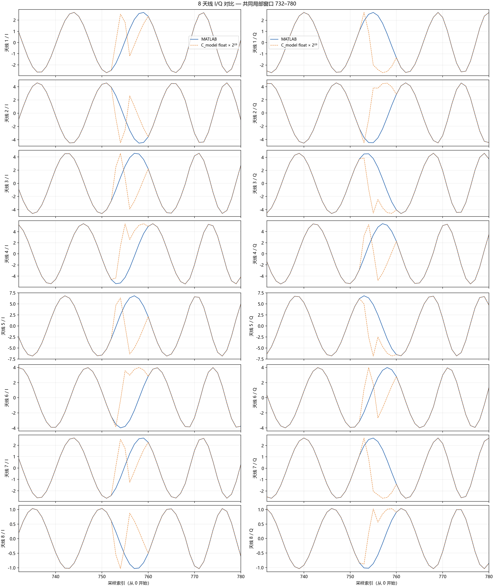

# TX 八天线 I/Q 叠加图与近零点检查

使用 2026-09-23 float 实测输出；仅绘图和统计，未重跑或修改算法。

## 图像入口

[完整一帧的 8 天线总图](all_antennas_full.png)

每根天线单独一张图，含 I、Q 完整波形、局部放大、复数幅度与误差：

- [天线 1](antenna_01.png)
- [天线 2](antenna_02.png)
- [天线 3](antenna_03.png)
- [天线 4](antenna_04.png)
- [天线 5](antenna_05.png)
- [天线 6](antenna_06.png)
- [天线 7](antenna_07.png)
- [天线 8](antenna_08.png)

## 应怎样比较

I、Q 各自叠加观察形状，误差用绝对值或整帧复数 RMS 归一化，避免用瞬时 I/Q 作为分母。主要指标为 `norm(C−M)/norm(M)`（整帧相对 L2 / RMS EVM）；复数包络为 `sqrt(I²+Q²)`。本图只还原 C++ 固定 2^23 缩放，不拟合增益/相位/延迟。

I 或 Q 过零时，逐点相对误差可能虚高，这一点成立。但本帧 MATLAB 复数包络基本恒定：每路最小和最大包络/整帧 RMS 均约为 1，复数幅度低于 1% RMS 的点为 0。因此本次 15.54%～15.55% 的整帧 L2 误差不是除以近零参考值造成。

## 误差分布

1% RMS 仅用于划分诊断区域，不是验收门限。保留全部点作为主结论；排除大误差点的指标只是显示其余区间的相似程度。

| 天线 | 整帧 L2/EVM | 大误差点数 | 所占误差能量 | 其余点 L2 | 峰值相位差 |
|---|---:|---:|---:|---:|---:|
| 1 | 15.5431% | 280 | 99.9717% | 0.2629% | 179.993° |
| 2 | 15.5472% | 280 | 99.9720% | 0.2617% | 179.993° |
| 3 | 15.5441% | 280 | 99.9720% | 0.2616% | 179.993° |
| 4 | 15.5453% | 280 | 99.9721% | 0.2609% | 179.993° |
| 5 | 15.5467% | 280 | 99.9721% | 0.2613% | 179.993° |
| 6 | 15.5464% | 280 | 99.9721% | 0.2611% | 179.993° |
| 7 | 15.5424% | 280 | 99.9714% | 0.2643% | 179.993° |
| 8 | 15.5470% | 280 | 99.9720% | 0.2615% | 179.993° |

每路大误差点占 1.0567%，集中在共同的局部窗口。首个较大差异从索引 753 开始；放大图包含最严重的索引 756，可见幅度未消失但波形/相位明显偏离。整帧误差能量相对参考能量约 2.416%～2.417%。

不能单凭这些点数量少就认定不影响接收；也不能直接据此认定会丢包。是否影响下行解调、频谱/EVM 要求，需要用同一接收模型解调两套下行波形，或按明确门限进一步验证。本次没有做该验证。

[完整数值指标 CSV](metrics.csv) · [来源哈希及 JSON](metrics.json)
