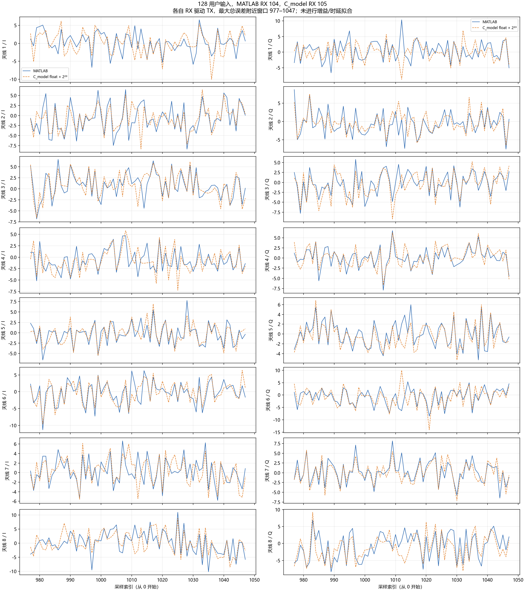

# 128 用户单帧 MATLAB / C_model float 对比

本次实际生成 128 个终端叠加的一帧数据，采用既有 case95 派生的 RX mode4 / TX mode14、8 天线、30 dB 配置、种子 1。关闭额外 CFO、漂移、时偏和干扰，随机用户频率/信道与原模型一致。

沿用现有 float（double）分支：TX 内部 SVD、RX Viterbi 状态仍含 fxp；这不是全链路纯 double。已知相位回绕问题未修复，未更改 FFT/SVD/BF/调制算法。

## RX 实测

MATLAB 104/128 = 81.25%；C_model 105/128 = 82.03125%。这是本次单帧统计，不是长期接收率。C++ 共有 107 次完整分段且 CRC 为零的候选解调事件，按有效接收结果去重后得到 105 个用户。

| 项目 | 结果 |
|---|---|
| 实际发送用户 | 128 |
| MATLAB 解调用户 | 104/128 |
| C_model 解调用户 | 105/128 |
| 共同用户 | 104 |
| 共同用户载荷逐字节相同 | 104/104 |
| MATLAB 对发送原文载荷错误 | [] |
| C_model 对发送原文载荷错误 | [] |
| 用户集合与载荷均一致 | False |

仅 MATLAB 收到：`[]`。
仅 C_model 收到：`[83]`。
MATLAB 未收到：`[10, 11, 13, 18, 30, 36, 41, 47, 50, 51, 56, 59, 61, 63, 71, 80, 83, 85, 87, 98, 107, 108, 122, 128]`。
C_model 未收到：`[10, 11, 13, 18, 30, 36, 41, 47, 50, 51, 56, 59, 61, 63, 71, 80, 85, 87, 98, 107, 108, 122, 128]`。

以当前数据生成器的用户编码 `byte0*255+byte1` 匹配，不按检测行序比较；每个用户比较 26 字节载荷，C++ 尾部 2 个 PHY 字节排除。此编码仅用于本模型测试向量，不等同于外部终端协议。

## TX 实测

共同 104 个用户的频率估计完全相同；AH 相对 L2 误差中位数约 0.0497%、最大约 0.0707%。共同用户 TX 权重误差中位数约 34.30%、最大约 162.13%；此处两边波束计算的用户集合与功率分配也不相同，不能将权重误差全部归因于定点 SVD。

各模型给自身成功解调的用户发送下行；TX 载荷由 128 用户 ID 索引的 bit bank 提供，每个用户 46 字节确定性载荷，不因检测顺序改变。C++ 日志中的全部 ID→bit 行映射已核对。

**若两边接收用户集合不同，以下总波形误差同时包含用户集合/平均功率分配差异，不能单独用来量化 TX 算法误差。没有丢弃不共同的用户来制造一致结论。**

基带形状：MATLAB `[26497, 8]`，C++ `[26497, 8]`（采样 × 天线）；125 ksample/s。MATLAB 1 Msample/s 的 8 天线最终波形也已保存。
C++ 仅还原固定 2^23 缩放；不拟合增益、相位或延迟。

| 天线 | 相对 L2 误差 | 复数 RMSE | 最大绝对误差 |
|---|---:|---:|---:|
| 1 | 64.4772% | 2.87532 | 19.2156 |
| 2 | 59.6128% | 2.68969 | 15.0281 |
| 3 | 54.7099% | 2.29767 | 11.9311 |
| 4 | 61.4627% | 2.14268 | 14.9391 |
| 5 | 46.4040% | 1.93241 | 16.0006 |
| 6 | 56.1868% | 2.74674 | 16.8782 |
| 7 | 58.8941% | 2.45362 | 12.5966 |
| 8 | 64.6654% | 3.05802 | 18.29 |

精确相等：`False`；流程状态：`completed_with_differences`。



## 复现与证据

```powershell
Set-Location 'D:\CodexWorkSpace\K2301Cmodel\c_model'
python .	estbench_GWRX_TX
un_multiuser_compare.py --users 128
```

退出 1 表示完整比较发现差异，不代表生成/程序运行失败。退出 2 才表示流程未完成。单帧观察不能推断长期丢包率；程序旧 LostRate 的 mode4 分母仍为 96，本报告不采用它，统计以 128 个发送 ID 为准。

- [全量比较 JSON](comparison.json)
- [128 用户逐行结果 CSV](rx_128user_details.csv)
- [MATLAB 日志](matlab.log)
- [C++ 构建日志](build.log)
- [C++ RX/TX 日志](cmodel.log)
- [C++ RX 结果](cmodel/K2201DemodModule_Data/case95/rx_frame0.txt)
- [C++ 8 天线 TX](cmodel/GWTXModule/case95/tx_frame0.txt)
- MATLAB 数据目录：`D:\CodexWorkSpace\K2301Cmodel\c_model\validation\multiuser_float_20260924_150540_506860\matlab`。含 `matlab_tx_8ant_baseband.txt`、`matlab_tx_8ant_rf.txt`、`matlab_one_frame.mat`、`matlab_results.json`、`tx_bits.txt`。

C++ 执行耗时：37.964 秒；MATLAB 耗时：106.53526699999999。仅作记录，不作为性能验收。

修改仅涉及多用户数据生成/匹配/载荷映射和结果输出；MATLAB 原工程由只读 hooks 调用。未修复已知相位问题或其他模型差异，未进行 RTL/硬件验证。

验证补充：

- 用户 ID 匹配检查覆盖了行序不同、缺失用户、额外用户及载荷不同的构造样例，结果符合预期。
- 新增 `--tx-user-ids-file`；配合 bit bank 按接收用户 ID 找到正确载荷行。105 个实际 TX 用户的映射全部核对成功。
- 用之前的单用户 MATLAB 帧回归，C++ float 输出哈希仍为 `cfd2a57783635fa548236dbacf2d582e0642ca0d2b5124d707b70dc0fab25b64`，与改动前相同。
- 最终构建/运行对应源码、输入文件及原 MATLAB `.m` 文件已作 SHA-256 核对；128 用户 CSV 共 128 行。
- 本轮第一轮在新增 MATLAB 结果结构体整理代码处失败，修正为逐字段赋值后重新完整运行。最终目录是本报告所在目录，首次失败目录不作为通过证据。
- 原入口、选项头文件及 MATLAB 验证驱动已备份到 `validation/baseline_before_128users_20260924/`；算法头文件没有修改。

输入 SHA-256：`74d49a64922b0a95820550d581616eca772fd29e82b5f5a5622565687e23e650`。

MATLAB 基带 TX SHA-256：`108c90cdb1154f859d26ffdd40dde8a41975bceaf2654f3a10726de93df4d360`。

C++ TX SHA-256：`704819f8f0815efa5e144b282ab9fcc136d1cf418f889b22e14f43088e4e4a1c`。
