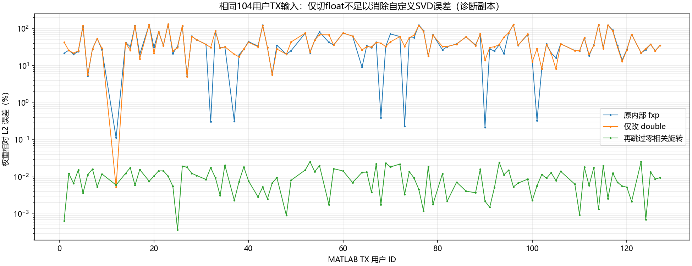

# TX 权重误差：fix 与 float SVD 受控诊断

日期：2026-09-24。结论：**不能仅靠把内部 `Cls_svd<fxp>` 改为 `Cls_svd<double>` 解决。大误差来自自定义 SVD 的近似开方、有限迭代与零相关量处理；精度类型只是其中一层。**

本轮所有改动只在 `validation/tx_svd_precision_*/.../source/` 的独立副本中。正式算法头文件、正式入口和 MATLAB 参考未修改；不能把下表诊断方案称为已合入的正式修复。

## 1. 对照条件

均使用之前从 MATLAB 导出的同一批104用户的 AH、噪声、频率、功率、校准、用户顺序和载荷。外层 RX/TX 为 double，已修复的相位回绕保持一致。每组运行均核对实际使用的TX输入及bit序列；原 fxp 控制组输出哈希与上一轮结果相同，验证插桩未改变基线。

矩阵输入、U/S/V、伪逆均以17位精度导出至各组 `output/tx_svd_trace.txt`。主波形仍直接与真实 MATLAB 输出比较；NumPy 仅用于独立定位，不替代 MATLAB 参考。

## 2. 104用户实测

| 诊断版本 | 权重误差中位数 | 权重最大误差 | 8天线TX相对L2范围 |
|---|---:|---:|---:|
| 原内部 fxp | 34.2356% | 133.56% | 42.6537%～60.3971% |
| 仅改 double | 34.8741% | 133.709% | 43.4460%～61.6765% |
| double + 标准开方，3轮 | 34.9486% | 133.697% | 43.6825%～61.5626% |
| double + 标准开方，10轮 | 7.42392% | 110.678% | 22.7829%～35.7185% |
| 再跳过零相关旋转 | 0.00894304% | 0.0257556% | 0.9104%～0.9882% |



**回答“改 float 会不会好”：仅改类型并不会好，本帧中位数从34.24%变为34.87%。修正浮点数值算法的组合诊断后，才降到0.008943%，最大0.025756%。最终波形仍约0.91%～0.99%，不属于精确一致。**

## 3. 原因及代码位置

### 3.1 仅改模板类型，开方仍不是标准浮点开方

`Cls_tx_beamforming.h:171` 将 SVD 固定实例化为 `Cls_svd<fxp>`。独立副本改为 `Cls_svd<T>` 后，量化赋值取消，但 `Cls_svd.h:410` 配置的22位逐位开方算法仍然存在：`Cls_sqrt::sqrt_bit()` 会将输入转成整数并执行位级运算。仅更改 `T` 不会把这一算法替换为 `std::sqrt`。
实测原 fxp / 仅 double 的 SVD 重构相对残差中位数分别约2.064% / 2.067%；改用标准开方后，3轮版本的重构残差降到约9.48e-16。说明近似开方确实是误差来源，但它不是全部原因。

### 3.2 固定3轮迭代不足，伪逆放大未收敛的小奇异值

`Cls_svd.h:472` 固定 `m_iter_num=3`，在 `svd_cal()` 中执行这些轮次，没有基于残差的收敛判断。`Cls_tx_beamforming.h:774` 以 `21*2^-21 ≈ 1.00136e-5` 判定保留奇异值，并在后续取倒数。
以第一个用户为例，参与其波束计算的用户为 `[1,72,94,101,126]`，矩阵为8×8但实际秩只有5。独立数值参考得到后三个奇异值约1e-16；仅改double、仍3轮的实现却得到约 `0.006336、0.000174、0.000101`，全部超过当前门限，导致本应删除的方向进入伪逆。
这不是单纯“末位有点量化噪声”：小奇异值被倒数放大后影响方向和干扰抑制权重。对同一C++矩阵改用独立标准伪逆，权重误差中位数约4.24e-15、最大0.01643%，进一步排除用户集合/矩阵组装为本帧大误差主因。
此外，本批还包含38个满秩矩阵；3轮版本在这些矩阵上权重误差也很大，不能仅把问题描述为秩亏输入。

### 3.3 零相关量分支会把列清掉

`Cls_svd.h:919–929`：当 `m_xiu_sqrt_fxp==0` 时，把 `m_xiu_norm` 和 `m_t_tmp` 都设为0，却继续执行旋转。随后 `m_s=0`、`m_c_xiu_norm=0`，在986行计算：

```text
A1_new = m_c_xiu_norm * A1 + m_s * A2 = 0
```

即使两列本来已经正交，也把第一列变为0；相应V列也受到影响。正确的零相关操作应保留列，不进行这次旋转。
所以单纯增加迭代次数也不稳妥：标准开方+10轮时误差虽降到7.42%，但仍有大误差；在这个基础上仅增加 `if(m_xiu_sqrt_fxp==0) return;`，权重中位数进一步降到0.008943%。这构成了该边界缺陷的受控验证。

最终诊断方案的104个矩阵，SVD重构相对残差中位数约1.40e-15，伪逆相对独立参考误差中位数约4.14e-15、最大2.13e-13。说明本帧伪逆层已恢复到双精度数值精度。

## 4. 结论与建议

- 不建议只把 `fxp` 文本替换成 `double` 后就当作问题解决。
- 建议后续给 float 路径使用真正的浮点开方，修正零相关量边界，并采用可验证的收敛判据和配套伪逆阈值。10轮仅是本批诊断值，不是已经证明适用于所有输入的固定上限。
- fixed/RTL路径需要独立保留与验收，不能把本次float诊断修改直接无差别应用到定点模型。
- 本轮尚未合入这些SVD改动。此前相位修复仍在正式代码中；本轮没有调整它。
- 剩余约0.009%的权重误差和约1%的波形误差，仍包含波束归一化/功率开方近似、频移步进近似等，不能宣称TX逐bit一致。

## 5. 证据与复现

- [汇总JSON](summary.json)；[104用户逐行误差CSV](weight_error_by_user.csv)。
- [最终诊断方案完整结果](comparison.json)。
- [最终矩阵trace](svd_double_std_sqrt_10sweeps_skip_zero/output/tx_svd_trace.txt)。
- [最终TX波形](svd_double_std_sqrt_10sweeps_skip_zero/output/GWTXModule/case95/tx_frame0.txt)。
- [最终运行日志](svd_double_std_sqrt_10sweeps_skip_zero/run.log)。

```powershell
Set-Location 'D:\CodexWorkSpace\K2301Cmodel\c_model'
python .\testbench_GWRX_TX\probe_tx_svd_precision.py
python .\testbench_GWRX_TX\probe_tx_svd_precision.py --variants svd_double_std_sqrt svd_double_std_sqrt_10sweeps svd_double_std_sqrt_10sweeps_skip_zero
```

补充：仅增加到10轮但继续使用原近似开方的一次诊断进程异常退出（0xC0000005），该组不列入有效数值结果，也未将其推广成正式修复。各实验均在隔离副本运行；最后核对了正式头文件和入口哈希未改变。
由于SVD头文件在副本中也被RX引用，扩展诊断的RX输出可能改变；本轮评估的是随后导入的同一份104用户MATLAB TX输入，不对扩展诊断的RX作验收结论。
